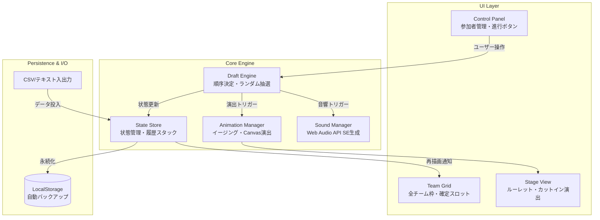

# システム基本・詳細設計書：スマブラ3on3 チームドラフト・ルーレット配信ツール

- **作成日**: 2026-10-12
- **参照要件定義書**: [code_artifact.md](../../code_artifact.md)
- **対象バージョン**: v1.0.0

---

## 1. システム概要・アーキテクチャ設計

### 1.1 設計方針
1. **完全スタンドアロン & ゼロ依存 (Zero-Dependency)**
   - OBS Studio内蔵ブラウザ（Chromium）および最新のGoogle Chromeで外部サーバーなしにローカル実行（`file://`またはローカル簡易サーバー）できるよう、**HTML5 / CSS3 / Vanilla JavaScript** で構築する。
   - 外部ライブラリに過度に依存せず、アニメーションはCSS3 + Canvas API、音声はWeb Audio APIによるシンセシス（内部生成）を基本として外部アセット欠落リスクをゼロにする。
2. **OBS親和性と高パフォーマンス（60fps保証）**
   - 1920×1080（16:9 フルHD）を基準キャンバスサイズとし、OBSブラウザソースでの取り込みに最適化。
   - レンダリング負荷を抑制するため、レイアウト再計算（Reflow）を避け、GPUアクセラレーション（`transform`, `opacity`, `will-change`）を活用する。
3. **二刀流画面設計（単一UIでの一体型 / OBS専用ビュー切替）**
   - 1画面で操作パネルと配信ステージを同時に確認できる「一体型コントロールUI」を基本としつつ、ワンクリックで「OBS配信用クリーンビュー（操作パネル非表示・背景透過）」への切り替え、またはOBS専用URLパラメータ（例: `?view=overlay`）に対応する。

### 1.2 システム全体構成図



---

## 2. データモデル・データ構造設計

### 2.1 型定義（JSDoc / TypeScript準拠）

```typescript
// 参加者エンティティ
interface Player {
  id: string;              // UUIDまたはタイムスタンプ連番 (例: "p_1697000000000_1")
  name: string;            // プレイヤー名 (必須)
  fighter?: string;         // 使用ファイター名 (任意)
  rate?: number;           // レート/シード値 (任意)
}

// チーム枠スロット
interface TeamSlot {
  slotNumber: number;      // 1 〜 3 (先鋒 / 中堅 / 大将 など)
  player: Player | null;   // 確定したプレイヤー (未確定時は null)
  confirmedAt?: number;    // 確定タイムスタンプ
}

// チームエンティティ
interface Team {
  id: string;              // "team_A", "team_B", ...
  name: string;            // "TEAM A", "TEAM B", ...
  slots: TeamSlot[];       // 要素数3の固定配列
}

// ドラフト進行ステップ
interface DraftTargetStep {
  stepIndex: number;       // 0 〜 N-1
  teamIndex: number;       // 対象チームのインデックス
  slotIndex: number;       // 対象スロット (0: 1人目, 1: 2人目, 2: 3人目)
}

// アプリケーション全体の状態 (AppState)
interface AppState {
  version: string;
  players: Player[];               // 登録済み全プレイヤー
  teams: Team[];                   // 生成された全チーム
  draftOrderMode: 'round' | 'team';// 'round': A-1->B-1->..., 'team': A-1,2,3->B-1,2,3
  draftQueue: DraftTargetStep[];   // 充填順序の予定リスト
  currentStepIndex: number;        // 現在進行中のステップ番号
  undrawnPlayerIds: string[];      // まだ選ばれていないプレイヤーID群
  isSpinning: boolean;             // ルーレット演出実行中フラグ
  history: AppHistoryState[];      // Undo用の状態スナップショット履歴
  settings: {
    seEnabled: boolean;            // 効果音 ON/OFF
    bgMode: 'transparent' | 'dark' | 'stage'; // OBS透過 / ダーク / ステージ背景
    spinDurationSec: number;       // ルーレット回転秒数 (デフォルト: 3.5秒)
    fontSizeScale: number;         // 視認性用フォント拡大率
  };
}

// Undo用スナップショット
interface AppHistoryState {
  currentStepIndex: number;
  teams: Team[];
  undrawnPlayerIds: string[];
}
```

---

## 3. モジュール詳細設計

### 3.1 参加者管理・I/Oモジュール (`ParticipantManager`)
- **責務**: 参加者の登録、編集、CSV/テキスト一括パース、3の倍数バリデーション。
- **主要メソッド**:
  - `importFromText(text: string): { successCount: number; errors: string[] }`
    - 改行区切りまたはカンマ区切り（`名前,キャラ,レート`）を自動判別パース。
    - 空行やトリミング後の空文字は除外、重複登録の警告。
  - `addPlayer(name: string, fighter?: string, rate?: number): Player`
  - `removePlayer(id: string): void`
  - `validateParticipantCount(): { isValid: boolean; count: number; remainder: number; teamCount: number }`
    - `count % 3 === 0` を判定。余りがある場合は警告メッセージ（「あと2名必要です」等）を算出。

### 3.2 ドラフト・抽選エンジン (`DraftEngine`)
- **責務**: チーム枠の初期化、ドラフト順序の構築、ランダム選出、Undo/Redo制御。
- **抽選アルゴリズム**:
  1. `buildDraftQueue(teamCount: number, mode: 'round' | 'team')`:
     - **ラウンド順 (round)**:
       $$\text{Queue} = [(T_0, S_0), (T_1, S_0), \dots, (T_{M-1}, S_0), (T_0, S_1), \dots, (T_{M-1}, S_2)]$$
     - **チーム完結順 (team)**:
       $$\text{Queue} = [(T_0, S_0), (T_0, S_1), (T_0, S_2), (T_1, S_0), \dots]$$
  2. `drawNext(onProgress: (candidate: Player) => void, onComplete: (selected: Player) => void)`:
     - `undrawnPlayerIds` から **Fisher-Yatesシャッフル** または暗号学的乱数 `crypto.getRandomValues()` を用いて当選者を1名決定。
     - アニメーション用のダミー候補プレイヤーリストを生成し、`AnimationManager`へ引き渡す。
  3. `undo()`:
     - 直前の `AppHistoryState` を復元し、スロットの当選者を未確定に戻し、未選出リストに再追加。

### 3.3 演出・アニメーションマネージャー (`AnimationManager`)
- **責務**: ルーレットの回転・イージング減速、スマブラ風カットイン演出、ヒットストップ、紙吹雪エフェクト。
- **演出フェーズ遷移**:
  ```text
  [待機状態]
      ↓ (「次の抽選を開始」クリック)
  [Phase 1: 高速ルーレット (約1.5秒)]
      - 未当選メンバーの名前が1フレームごとに高速切り替え
      - ピッチの上昇するスロット回転SE
      ↓
  [Phase 2: イージング減速 (約1.5秒)]
      - Cubic-Bezier または Quintic Ease-Out で徐々に間隔が広がる
      - カチッ... カチッ... と1コマずつテンポが落ちる
      ↓
  [Phase 3: スマブラ風 確定カットイン (約0.8秒)]
      - 画面一瞬フラッシュ (ホワイトアウト / スラッシュ切断エフェクト)
      - 当選者名が特大ズームイン + 画面シェイク (Hitstop & Shake)
      - 「ドンッ！」と重低音SE
      ↓
  [Phase 4: チームスロット格納]
      - 対象チームの該当枠へ吸い込まれるように名前が固定配置
      - 枠がゴールドに発光
  ```
- **フィナーレ演出 (全枠確定時)**:
  - Canvasによる2Dパーティクル（紙吹雪 / スパークエフェクト）を発火。
  - 全チームの確定一覧がパッと強調表示される。

### 3.4 サウンドマネージャー (`SoundManager`)
- **Web Audio APIによる内部シンセシス（外部音声ファイル不要の自律動作）**:
  - **ルーレット回転音 (`playTick`)**: 短い矩形波（Pulse）クリック音（約15ms、800Hz〜1200Hz）。
  - **ドラムロール/テンション上昇 (`playTension`)**: 周波数を徐々にスウィープ。
  - **確定打撃音 (`playImpact`)**:
    - 低域のサイン波（150Hz $\to$ 40Hz 急速ピッチダウンでバスドラムの衝撃）
    - ホワイトノイズ＋バンドパスフィルタによるクラッシュ音のレイヤー合成。
  - **ファンファーレ (`playFanfare`)**: メジャーコードのアルペジオシンセ。
  - ※OBSで音割れしないようマスターゲイン（Compressor / Limiter）を挟む。

---

## 4. UI/UX・画面設計

### 4.1 配信画面（ステージ）ビジュアルコンセプト
- **世界観**: スマブラの大会UI（「大乱闘」「参戦」をイメージしたスタイリッシュ＆エネルギッシュなデザイン）。
- **カラーパレット**:
  - メイン背景: `#0b0e14` (ディープダークネイビー) / 透過モード時は `rgba(0,0,0,0)`
  - アクセント1 (炎・情熱): `#ff3b30` / `#ff5e3a`
  - アクセント2 (スマブラゴールド): `#ffcc00` / `#ffd700`
  - UIサーフェス: `rgba(20, 26, 40, 0.85)` (すりガラス効果 backdrop-filter: blur)
  - テキスト: `#ffffff` (黒フチどり text-shadow: 2px 2px 0 #000, -2px -2px 0 #000)
- **タイポグラフィ**:
  - 英数字: インパクトの強い太字サンセリフ（`Impact`, `Montserrat (Black)`, またはシステム太字）
  - 日本語: 視認性の高い極太ゴシック（`Noto Sans JP`, `Hiragino Kaku Gothic`, `Meiryo`）

### 4.2 レイアウト仕様（1920×1080 基準）

```text
+-----------------------------------------------------------------------------------------------+
| [ヘッダー] 大会ロゴ / タイトル「SMASH 3on3 DRAFT STAGE」        [現在: 8/24人 確定 (Team C 2人目)]|
+-----------------------------------------------------------------------------------------------+
|                                                                                               |
|   +-------------------【 メイン ルーレット・カットインステージ 】----------------------+   |
|   |  [NEXT SLOT]  TEAM C - 2人目 (中堅)                                                |   |
|   |  +-------------------------------------------------------------------------------+ |   |
|   |  |                   ★ ★ ★  [ プレイヤー名表示枠 ]  ★ ★ ★                       | |   |
|   |  |                  (巨大フォント / 斜線カットインエフェクト)                       | |   |
|   |  +-------------------------------------------------------------------------------+ |   |
|   +------------------------------------------------------------------------------------+   |
|                                                                                               |
|   +--------------------------【 全チームグリッド一覧 】--------------------------------+   |
|   |  [TEAM A]          [TEAM B]          [TEAM C (現在)]     [TEAM D]           ...        |   |
|   |  1. プレイヤー1    1. プレイヤー4    1. プレイヤー7      1. (待機中)                   |   |
|   |  2. プレイヤー2    2. プレイヤー5    2. [ 抽選中!! ]     2. (待機中)                   |   |
|   |  3. プレイヤー3    3. プレイヤー6    3. [ 未確定 ]       3. (待機中)                   |   |
|   +------------------------------------------------------------------------------------+   |
|                                                                                               |
+-----------------------------------------------------------------------------------------------+
| [フロート操作バー (配信時は非表示/透過可能)]                                                  |
| [ ▶ 次を抽選 (Space) ] [ ↩ 1手戻す (Ctrl+Z) ] [ ⚙ 設定・参加者リスト ] [ 📺 OBS透過モード切替 ]|
+-----------------------------------------------------------------------------------------------+
```

---

## 5. 状態永続化・フォールトトレランス設計

1. **LocalStorage自動同期 (`Auto-Save`)**
   - 参加者の変更、抽選の進行（1手進むごと）のタイミングで即座に `localStorage.setItem('fof_3on3_draft_state', JSON.stringify(appState))` を実行。
   - ブラウザがクラッシュしたり誤ってF5リロードされた場合でも、起動時に自動復元して「直前の確定状態」から再開可能。
2. **安全装置（誤操作ガード）**
   - **全リセット**: 確認モーダルで「確定したチーム編成をすべて初期化しますか？」の2段階確認。
   - **抽選連打防止**: ルーレット回転中（`isSpinning === true`）は、進行ボタンおよびショートカットキーを無効化。
3. **ホットキー対応（運営のキーボード1つで進行）**
   - `Space`: 次の抽選を開始
   - `Z` または `Ctrl+Z`: 1手戻す（Undo）
   - `Esc`: モーダルを閉じる / 設定画面を閉じる
   - `H`: 操作コントロールバーの表示/非表示トグル（OBS直キャプチャ用）

---

## 6. ファイル構成・実装構造

本設計に基づくWebアプリケーションのファイル構成は以下の通りとする。

```text
random_team_maker_4_3on3/
│
├── index.html              # メインエントリーポイント（全画面マークアップ）
├── index.css               # スマブラ風デザインシステム、アニメーション、レスポンシブ
│
├── js/
│   ├── app.js              # 全体初期化・イベントリスナー・メインループ
│   ├── state.js            # AppState管理・LocalStorage永続化・Undoスタック
│   ├── draft-engine.js     # 順序キュー生成・乱数選出ロジック
│   ├── audio.js            # Web Audio API シンセサイザー（回転音・打撃音・ファンファーレ）
│   ├── animation.js        # ルーレットイージング・画面シェイク・カットイン・Canvas紙吹雪
│   └── participants.js     # テキスト/CSVインポート・バリデーション
│
├── assets/                 # (必要に応じてカスタムSEやロゴ画像を配置可能)
│
├── code_artifact.md        # 要件定義書（元資料）
└── docs/
    └── system_design/
        └── design_document.md # 本設計書
```

---

## 7. テスト・動作検証計画

| テスト項目 | 検証内容 | 期待結果 |
|---|---|---|
| **インポート検証** | 24名分のプレイヤー名をテキストエリアに改行区切りで貼り付け | 24名が正しく認識され、Team A〜H（8チーム）が生成されること |
| **バリデーション検証** | 23名（3の倍数でない）を投入 | 「23名登録中: あと1名不足しています」と警告が表示され、開始できないこと |
| **順序制御検証 (ラウンド順)** | 抽選を順次実行 | Team A(1) $\to$ Team B(1) $\to \dots \to$ Team H(1) $\to$ Team A(2) の順で埋まること |
| **Undo動作検証** | 3人確定した状態でUndoを2回実行 | 3人目、2人目のスロットが空に戻り、未選出リストに正しく復帰すること |
| **リロード復元検証** | 5人確定した時点でブラウザをF5リロード | リロード後も5人確定済みの状態がそのまま復元されること |
| **OBS取り込み検証** | OBS StudioのブラウザソースとしてURLを指定 | 透過背景が正常に透過され、60fpsでスムーズにアニメーションと音声が再生されること |
